# Compte rendu — Labos NoSQL / NewSQL (Séquences 1, 2 et 3)
**Étudiant : Kine MBOUP — Classe : M2IAGE**
**Compte GitHub : mboup952**

Projet fil rouge : **Teranga Market** (commerce en ligne).
Environnement : Docker Desktop (Windows, WSL2) ; chaque labo est un projet Docker Compose lancé séparément.
Bases utilisées : PostgreSQL 16, MongoDB 8.0, Cassandra 5.0, Redis 7.4, Neo4j 5.26.

---

## Séquence 1 — Du relationnel au NoSQL

**Objectif.** Charger un modèle relationnel dans PostgreSQL, le transformer en documents MongoDB, puis comparer les deux approches.

### Capture n° 1 — Requête PostgreSQL et plan d'exécution (`EXPLAIN`)

Commande : `docker exec -it s1-postgres psql -U teranga -d teranga -f /sql/04_requete.sql`

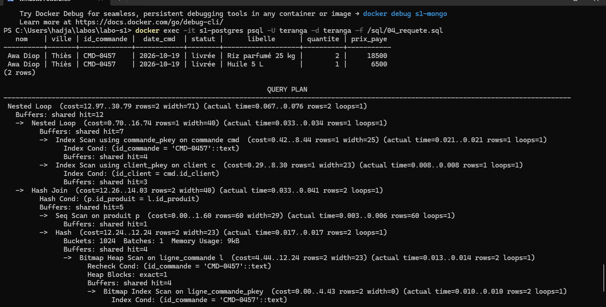
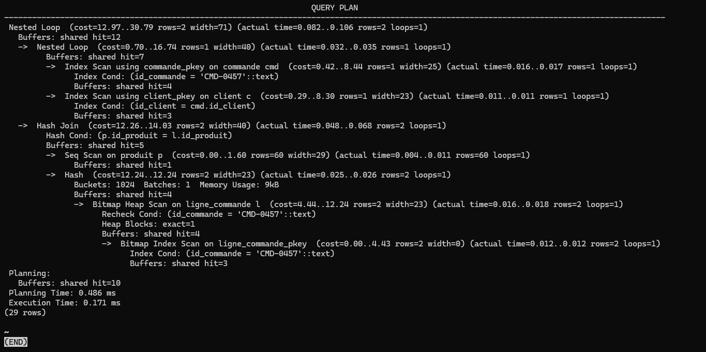

*Lecture.* La requête reconstitue la commande `CMD-0457` d'Awa Diop (2 lignes : riz 25 kg et huile 5 L). Le plan utilise des **Index Scan** sur `commande_pkey` et `client_pkey`, un **Hash Join** avec la table `produit`, et s'exécute en **0,171 ms**. Le relationnel obtient ce résultat grâce à **4 tables jointes** : c'est ce que le document MongoDB cherche à éviter.

### Capture n° 2 — Le même client dans MongoDB (Compass et mongosh)

**A. Document d'Awa Diop** : les commandes sont **imbriquées** dans le document client (tableau `commandes`, 4 éléments).

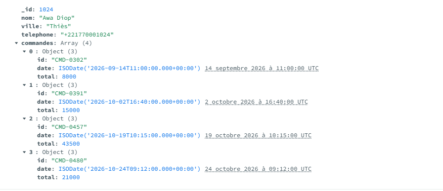

**B. Variabilité du schéma** : 500 clients, dont 15 sans champ `telephone`, soit **97 %** avec téléphone et **3 %** sans. MongoDB accepte cette souplesse sans migration.

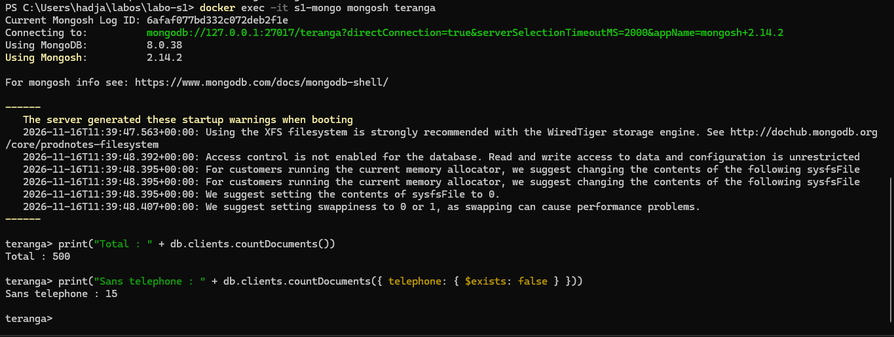

### Capture n° 3 — Popularité des bases (DB-Engines)

Classement de novembre 2026, consulté le **16/11/2026**.

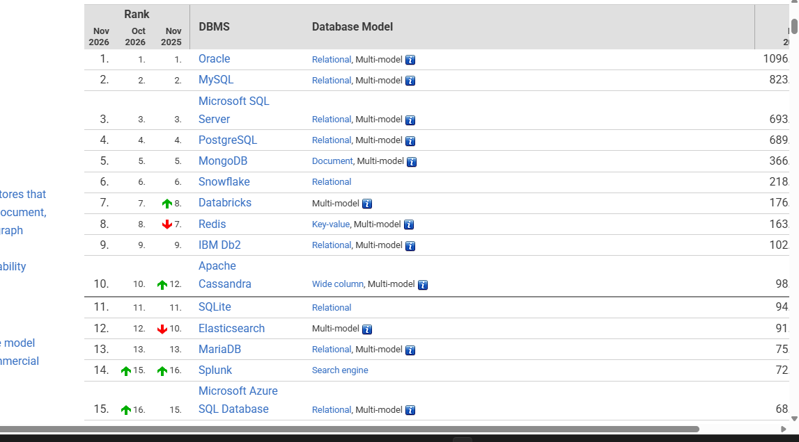

| Rang | Base | Modèle |
|---|---|---|
| 4 | PostgreSQL | Relationnel |
| 5 | MongoDB | Document |
| 8 | Redis | Clé-valeur |
| 10 | Apache Cassandra | Colonnes larges |
| 20 | Neo4j | Graphe |

*Conclusion S1.* Chaque modèle de données répond à un besoin différent : c'est la logique de la **persistance polyglotte**.

---

## Séquence 2 — Systèmes distribués

**Objectif.** Observer la réplication, la tolérance aux pannes et la cohérence ajustable.

### Capture n° 1 — Basculement automatique MongoDB (replica set `rs-teranga`, 3 nœuds)

Avant la panne : `mongo3` est PRIMARY.

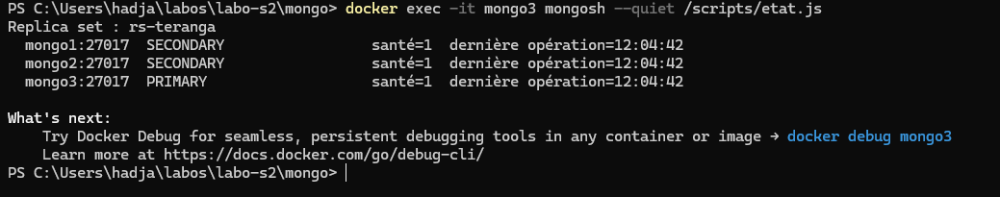

On arrête le PRIMARY (`docker stop mongo3`). Après environ 15 secondes, une **élection** désigne `mongo1` comme nouveau PRIMARY ; `mongo3` apparaît `(not reachable/healthy)`.

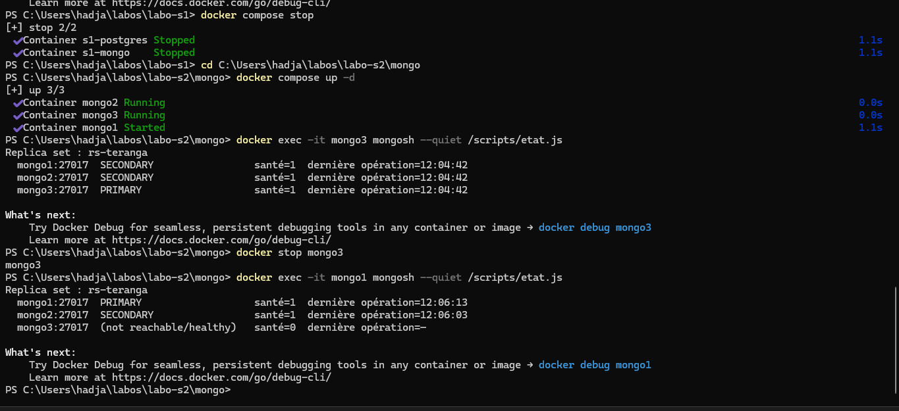

*Lecture.* Le cluster reste disponible tant que la **majorité** des nœuds répond (2 sur 3). C'est un comportement de type **CP** : la cohérence est préservée, et l'écriture est refusée si la majorité est perdue.

### Capture n° 2 — Cluster Cassandra à 3 nœuds

Tous les nœuds sont `UN` (Up / Normal), avec un partage des données (`demo_rf1`, une seule copie : chaque client vit sur un seul nœud).

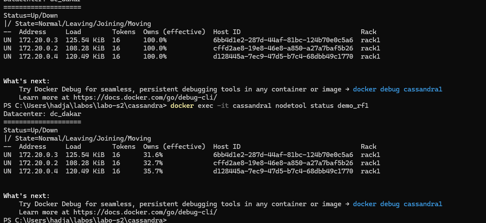

Après `docker stop cassandra3`, un nœud passe en **`DN`** (Down / Normal) ; le cluster continue de répondre.

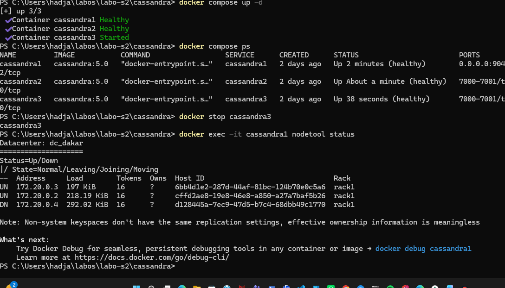

### Capture n° 3 — Niveaux de cohérence (keyspace `teranga`, réplication 3)

Avec un nœud arrêté, `CONSISTENCY QUORUM` fonctionne (2 réponses sur 3 suffisent) :

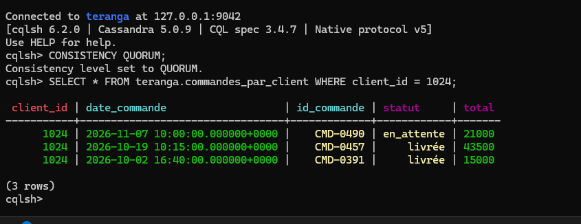

`CONSISTENCY ALL` échoue (`required_replicas: 3`, `alive_replicas: 2`) :

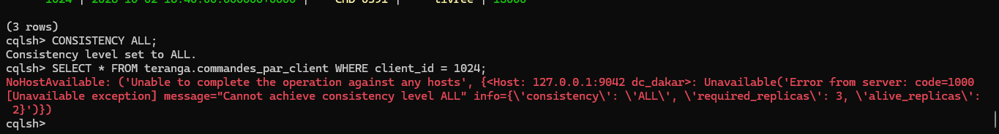

*Lecture.* Plus le niveau de cohérence est strict, moins le système est disponible en cas de panne. Cassandra laisse choisir ce compromis requête par requête (théorème CAP, règle **R + W > N** pour les lectures cohérentes).

### Simulations Python

Trois scripts illustrent les principes : hachage cohérent (répartition des clés sur des nœuds), quorums (R + W > N) et horloge de Lamport (ordre des événements).

---

## Séquence 3 — Modélisation orientée requêtes

**Objectif.** Choisir la bonne base et le bon modèle pour chaque besoin.

### Capture n° 1 — Redis (clé-valeur) : panier, passages, positions, ventes

Redis Insight : familles de clés `panier` (101), `passages` (1), `positions` (1) et `ventes` (30, un *sorted set* par jour).

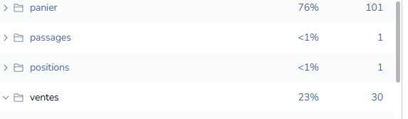

### Capture n° 2 — MongoDB : index et plan d'exécution (200 000 avis)

Requête : avis du produit `P-778`, triés par date décroissante.

**Sans index** : `COLLSCAN`, **200 000** documents examinés, tri en mémoire, **398 ms**.

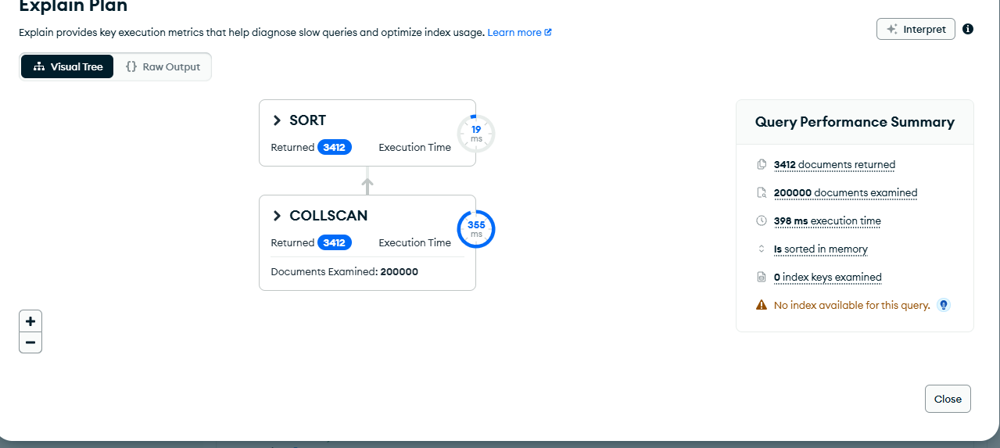

**Avec l'index `produit_id_1_date_-1`** : `IXSCAN`, **3 412** documents examinés (exactement ceux renvoyés), pas de tri en mémoire, **98 ms**.

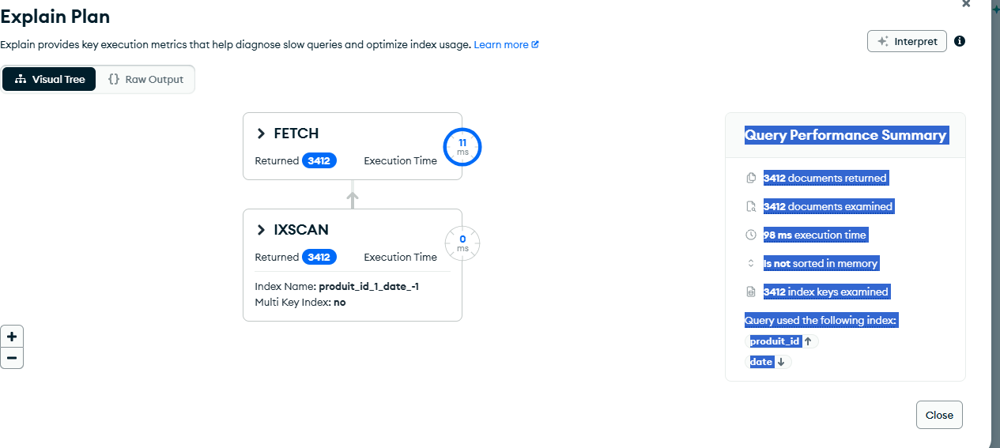

*Lecture.* L'index composé répond au filtre **et** au tri : on lit 3 412 entrées au lieu de 200 000 documents.

### Capture n° 3 — Neo4j : recommandation par graphe

Requête Cypher : clients ayant acheté le produit `P-778`, et les autres produits qu'ils ont achetés (6 clients, 6 produits, 25 relations `A_ACHETE`).

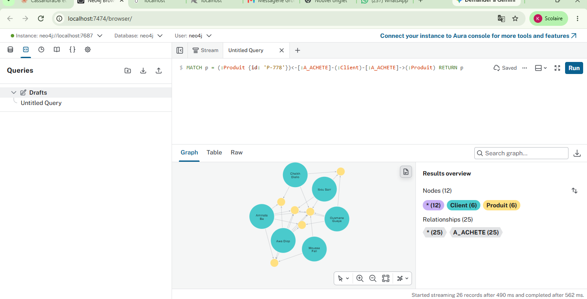

*Lecture.* Une relation « a acheté » se parcourt directement dans le graphe, sans jointure : c'est adapté aux recommandations.

### Cassandra (modélisation par requête)

Une table par requête (`commandes_par_client`), clé de partition = `client_id`, tri par date décroissante.

---

## Conclusion

| Besoin | Base choisie | Raison |
|---|---|---|
| Transactions, intégrité | PostgreSQL | ACID, jointures |
| Documents évolutifs | MongoDB | Schéma souple, documents imbriqués, index |
| Haute disponibilité, écriture massive | Cassandra | Réplication, cohérence ajustable |
| Accès très rapide (panier, classements) | Redis | En mémoire, structures dédiées |
| Relations et recommandations | Neo4j | Parcours de graphe |

*Aucune base ne les remplace toutes : on choisit selon la requête dominante.*
